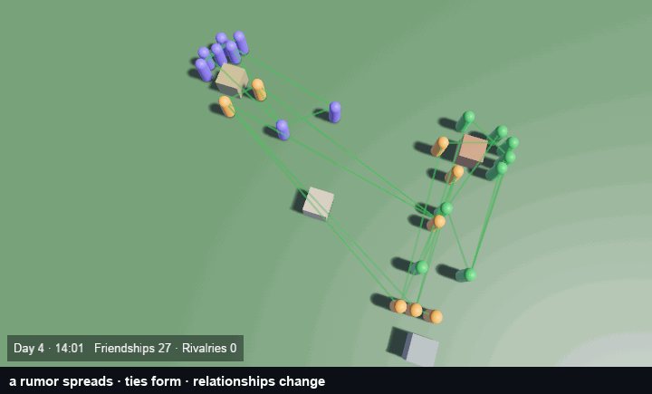

# bevy_society

> ⚠️ **Vibe Coded.** Written by AI agents working from a human's direction, covered by tests rather than a line-by-line human review. Read the code before you rely on it for something you care about.

Give your Bevy world a living society: villagers who remember, gossip, take sides, fall out and make up, and whose days you can script.

[](https://crates.io/crates/bevy_society) [](https://docs.rs/bevy_society) [](https://github.com/bevy-coven/bevy_society/actions/workflows/ci.yml) [](https://bevyengine.org) [](LICENSE-MIT)



*`cargo run --release --example capture -- --scene village`: one afternoon in a village of twenty-four people. A weaver tells the rumor that Bram stole bread, ties form and thicken, and the plate in the corner counts friendships and rivalries.*

**Status:** usable · Bevy 0.20 · MSRV 1.97.1

**Why this crate rather than writing your own villagers:** every model here is one social-psychology or game-AI paper's mechanism with its numbers in the open as named fields on `Tuning`, so a village behaves like one — friendship stays scarce, a rumor crosses the village in game-days rather than hours, a full tavern costs instead of vanishing — and every behaviour is deterministic for a seed, so a bug is reproducible and a save reloads into the society that would have followed.

## Quick start

The starter pack supplies the needs, activities, interactions and triggers; spawn a place and some people and the village runs. This block is the crate's own doctest — `tests/readme.rs` fails if the two ever differ.

```rust,no_run
use bevy::prelude::*;
use bevy_society::{
    Autonomous, Home, Person, Place, PlaceTags, SocietyClock, SocietyDefs, SocietyPlugins,
    SocietySettings,
};

let defs = SocietyDefs::starter().expect("the starter pack is valid");
// A headless app has no frame clock, so `Time<Fixed>` never advances on its own. Without this the
// society takes zero ticks however many updates you run.
let step = std::time::Duration::from_secs_f64(1.0 / 64.0);

let mut app = App::new();
app.add_plugins((MinimalPlugins, TransformPlugin))
    .insert_resource(bevy::time::TimeUpdateStrategy::ManualDuration(step))
    .insert_resource(SocietySettings::default())
    .insert_resource(defs);
// `DialoguePlugin` needs a speech-bubbles plugin over a camera, which this snippet has not.
let plugins = SocietyPlugins.build();
#[cfg(feature = "dialogue")]
let plugins = plugins.disable::<bevy_society::DialoguePlugin>();
app.add_plugins(plugins);

let well = app
    .world_mut()
    .spawn((Name::new("well"), Place { capacity: 6 }, PlaceTags(vec!["gathering".into()]), Transform::default()))
    .id();
for name in ["Bram", "Alys", "Corin"] {
    app.world_mut()
        .spawn((Person, Autonomous, Name::new(name), Home(well), Transform::default()));
}

for _ in 0..600 {
    app.update();
}
// The society advanced: this line is what proves the fixed step was pinned.
assert!(app.world().resource::<SocietyClock>().tick > 0);
```

`cargo run --example quickstart` runs exactly this headlessly and reports `229 social exchanges, 112 accepted` on this code.

## Try it

```sh
cargo run --example village -- /System/Library/Fonts/Supplemental/Arial.ttf
```

The full village — the scene the clip above is recorded from — with speech balloons and a debug server. Font paths: macOS `/System/Library/Fonts/Supplemental/Arial.ttf`, Linux `/usr/share/fonts/liberation/LiberationSans-Regular.ttf`, Windows `C:\Windows\Fonts\arial.ttf`.

## What you can do

- **Give people a mind.** Big Five personalities, moods on a pleasure/arousal/dominance (PAD) axis, an OCC emotion set, needs that decay and memories that fade, and a `Chronotype`, so a lark and an owl keep their own hours in one village. [features](docs/guide/features.md#people-with-a-mind)
- **Let them decide their own day.** Utility-AI scoring over tagged places and other people, with travel, arrival, durations and per-tier ranks; an activity can declare an urgency that wins its tier while a need is low. [features](docs/guide/features.md#daily-life-and-trades)
- **Watch relationships form and break.** Directed ties with affinity, trust, respect and familiarity, a Dunbar-style cap (Dunbar's number, the limit on how many people one person keeps up with), friend and rival labels with hysteresis, and rebuff memory, so someone turned down stops asking. [features](docs/guide/features.md#relationships)
- **Run opinions, rumors, reputation and factions.** Bounded-confidence influence, Daley–Kendall gossip (a teller is stifled when the listener already knows), witnesses who judge deeds and hold grudges, in-group affinity and conferred standing. [features](docs/guide/features.md#opinions-rumors-reputation-and-factions)
- **Script it in Rhai.** Triggers over a per-tick snapshot, bound to an area, a faction or named people, with a `ctx` reader and an `fx` writer that cannot see its own writes. [scripting](docs/guide/scripting.md)
- **Give it an economy and a save file.** Goods as quantities with a per-head price, sharing and swapping between people, and `capture`/`restore` of the whole society: ties, memories, rumors, the clock and the random stream. [features](docs/guide/features.md#a-basic-economy) · [persistence](docs/guide/persistence.md)
- **Drive it from an editor.** `fast_forward`, `preview_forward` (run a day, report what moved, put it back), `test_trigger`, `check_script` and `place_dependents`. [editor](docs/guide/editor.md)

Every formula traces to a paper; every rate is a named field on `Tuning`; every default either comes from a paper or says it is a design default.

## Part of the Coven

`bevy_society` is one crate of [the Bevy Coven](https://github.com/bevy-coven), a family that builds the hand-authored parts of games — levels, set dressing, dialogue, villagers' lives, UI and weather — so they scale under agent use. [Grimoire](https://github.com/bevy-coven/bevy_grimoire) hosts it as an optional cargo feature and edits its settings file live; [the book](https://bevy-coven.github.io/crates/bevy_society.html#use-it-in-grimoire) shows how.

## Cargo features

| feature | default | turns on |
|---|---|---|
| `dialogue` | yes | `DialoguePlugin`, `TalkTo`, barks and conversations through `bevy_speech_bubbles`. The host adds `SpeechBubblesPlugin` over its own camera. |
| `steering` | yes | `SteeringPlugin`: `SocialMover` walking under ORCA (optimal reciprocal collision avoidance, `bevy_orca`), and `Obstacle`. |
| `fields` | yes | `SocialFieldPlugin`: crowd presence and commotion grids and per-faction presence grids (`bevy_stigmergy`), the `Field` consideration and the `Gradient` target. |
| `serde` | no | `SocietySave`, `capture`, `restore` and `preview_forward`: save, load and preview the whole society. |
| none (`--no-default-features`) | | the core: mind, daily life, relationships, opinions, rumors, reputation, factions, scripts and `DecisionTrace`. |

`SocietySettings` and `SocietyDefs` must be inserted **before** `SocietyPlugins`. With `dialogue` on, `DialoguePlugin` **panics in `finish`** without `bevy_speech_bubbles::SpeechBubblesPlugin::<YourCamera>`: add that first, or `.disable::<DialoguePlugin>()` as the quick start does.

## Built on

| Crate | Used for | Source |
|---|---|---|
| Bevy | the engine | <https://github.com/bevyengine/bevy> |
| bevy_speech_bubbles | barks and conversations (`dialogue`) | <https://crates.io/crates/bevy_speech_bubbles> |
| bevy_stigmergy | per-cell presence and commotion fields (`fields`) | <https://crates.io/crates/bevy_stigmergy> |
| bevy_orca | reciprocal collision avoidance for walkers (`steering`) | <https://crates.io/crates/bevy_orca> |
| bevy_grimoire_rng | the seeded ChaCha8 stream | <https://crates.io/crates/bevy_grimoire_rng> |
| Rhai | trigger and effect scripts | <https://github.com/rhaiscript/rhai> |
| serde | authored definitions | <https://github.com/serde-rs/serde> |
| RON | the definitions' file format | <https://github.com/ron-rs/ron> |
| rand_chacha | names the ChaCha8 generator the stream comes from | <https://github.com/rust-random/rand> |
| bevy_fairy | the agentic debugger in the village example | <https://github.com/bevy-coven/bevy_fairy> |

## Bevy compatibility

| bevy_society | Bevy |
|---|---|
| 0.1 to 0.9 | 0.20 |

## Learn more

- [docs.rs](https://docs.rs/bevy_society) — the API.
- [The book page](https://bevy-coven.github.io/crates/bevy_society.html) — this material with the full gallery.
- [`docs/guide/`](docs/guide/README.md) — getting started, concepts, a tour, features, authoring, scripting, dialogue, decisions, persistence, editors.
- [`examples/`](examples) — `quickstart`, `village`, `capture`, `benchmark`, `absence`, `evidence`.
- [The gallery](docs/gallery.md) — one clip per feature, and the recipe for each.
- [`CHANGELOG.md`](CHANGELOG.md) — what changed in each release.

## The science

Every model is distilled from a paper held in a local corpus. `docs/research/README.md` maps each source module to its papers and its note, and every note says which constants are design defaults.

| Module | Key papers | Note |
|---|---|---|
| Personality and mood | Mehrabian 1996 · Gebhard 2005 (ALMA) | [note](docs/research/personality-and-mood.md) |
| Body clocks | Roenneberg et al. 2007 · Fischer et al. 2017 · Wittmann et al. 2006 | [note](docs/research/chronotype.md) |
| A week | Sekara et al. 2016 · Dodds et al. 2011 | [note](docs/research/weekly-rhythm.md) |
| Needs and utility | Mark & Dill (Game AI Pro 3 ch. 13) · Dill 2015 | [note](docs/research/needs-and-utility.md) |
| Relationships | Heider 1946 · Zajonc 1968 · Dunbar 1992 | [note](docs/research/relationships.md) |
| Rejection and re-approach | Maner et al. 2007 · Downey & Feldman 1996 · Bondü & Richter 2016 | [note](docs/research/rebuff.md) |
| Opinions | Deffuant et al. 2000 · Friedkin & Johnsen 1990 · Asch 1956 | [note](docs/research/opinion-dynamics.md) |
| Rumors and reputation | Daley & Kendall 1964 · Nowak & Sigmund 1998 · Ohtsuki & Iwasa 2004 | [note](docs/research/rumor-and-reputation.md) |
| Factions and status | Tajfel et al. 1971 · Pettigrew & Tropp 2006 · Bonabeau et al. 1995 | [note](docs/research/groups-and-status.md) |
| Memory | Park et al. 2023 · Anderson & Schooler 1991 | [note](docs/research/memory.md) |
| Social simulation in games | Game AI Pro chapters · McCoy et al. 2014 | [note](docs/research/social-simulation-games.md) |

The papers were gathered with [home-still](docs/research/corpus/README.md), a local corpus pipeline; `docs/research/README.md` lists a DOI and a corpus id for every mechanism.

## Who and licence

Maintained by [@Ladvien](https://github.com/Ladvien). Bug reports and questions go to [the issues](https://github.com/bevy-coven/bevy_society/issues); contributions follow the org's [`CONTRIBUTING.md`](https://github.com/bevy-coven/.github/blob/main/CONTRIBUTING.md), and agents working in this repository should read [`AGENTS.md`](AGENTS.md) first (it lists the invariants a change must not break).

MIT OR Apache-2.0, at your option.
