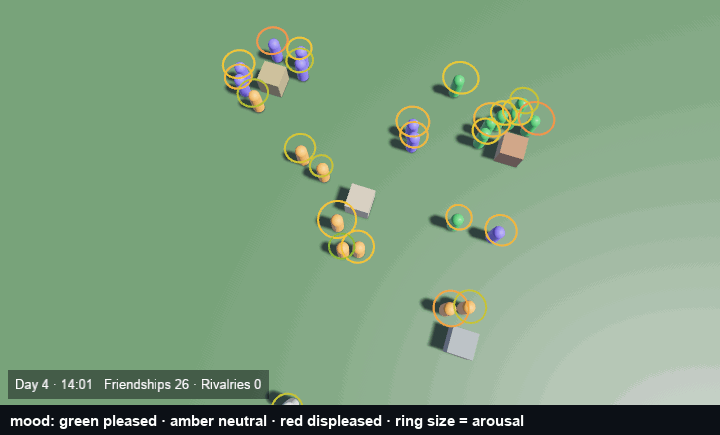
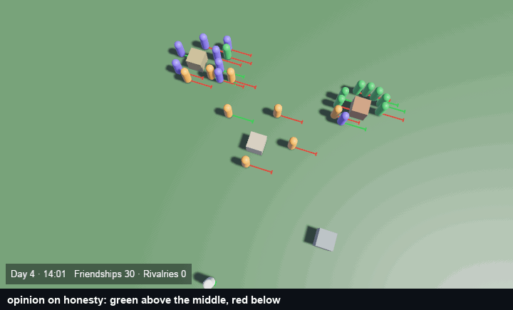
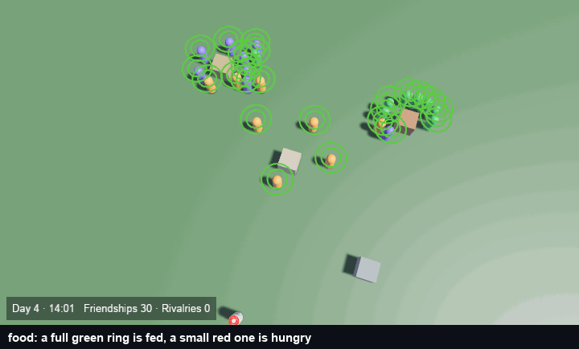
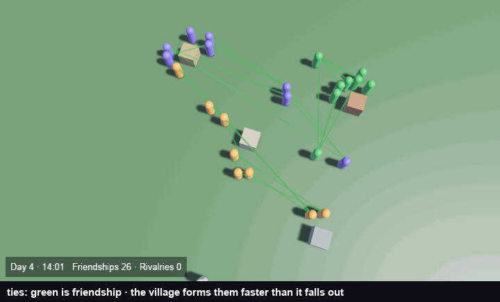
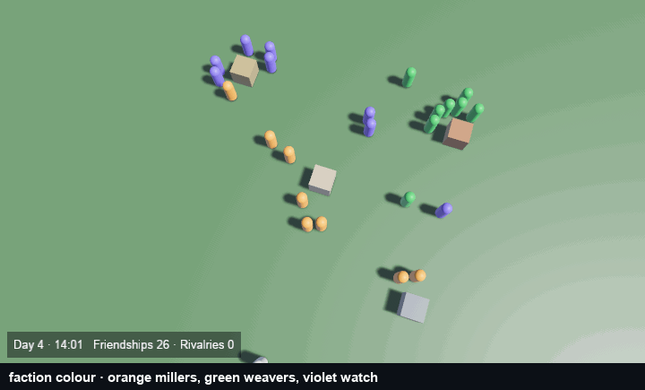
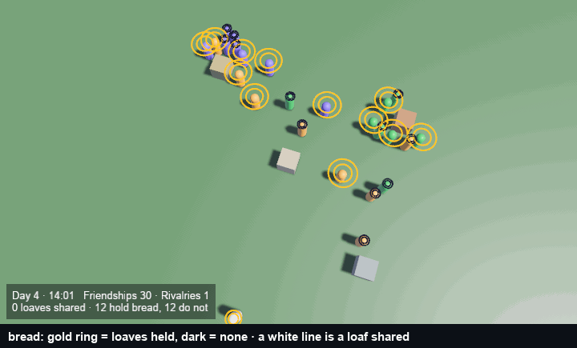

# Gallery

Every clip here is a recording of `examples/capture` with a different `--scene`, so they are not hand-made overlays: the same village, the same seed and the same run, drawn differently. [`DEMOS.md`](DEMOS.md) is the recipe — the scene each clip is recorded from, the camera, the encode, and what a visual review has caught in each rebuild. [`media/README.md`](media/README.md) lists every file with its date and the version it shows.

## The hero clip

One afternoon in a village of twenty-four people. The plate in the corner reads `Day 4 · 14:01  Friendships 30 · Rivalries 1` on the first frame and `Day 4 · 20:01  Friendships 27 · Rivalries 1` on the last, with `“Bram stole bread” — known by 2/24` once the rumour is planted at frame 30: a weaver tells it, and inside the six game-hours the clip covers it reaches one more villager. Which weaver tells matters — of ten tellers tried on 2026-10-25, four passed it on inside six hours and six did not ([`DEMOS.md`](DEMOS.md#which-teller-and-what-the-rumor-line-means)) — so a rumour crosses a village in game-days, not hours: each telling is one choice among many, and the Daley–Kendall rule stifles a teller whose listener already knew. Tie lines are green for friendship and red for rivalry; the magenta ring marks whoever knows the rumour.

The first frame already carries **one rivalry**, which the 2026-10-25 set did not: `Tuning::forgiveness` (0.7.0) changed how the settled village's ties form, so a rivalry now survives the settle steps and the clip draws one. A longer run forms many more — 28 directed rival ties against 62 friend ties at seed 7 over 17 game-days (`examples/evidence`, [`loop/runs/2026-10-30-25/eval.md`](loop/runs/2026-10-30-25/eval.md)).

## One clip per feature

| | |
|---|---|
|  **Mood** — a halo on every villager. Green is pleased, amber neutral, red displeased; halo size is arousal. The colour scale is normalised to the ±0.45 this village actually spans (`MOOD_SPAN`), so a small mood shift is a visible colour change rather than every villager the same olive. |  **Opinions** — one bar per villager on the honesty topic, green above the midpoint and red below, length by strength, all drawn from a fixed origin so a near-neutral opinion is still legible. |
|  **Needs** — a full green halo is a fed villager, a small red one is hungry. |  **Relationships** — the tie graph alone: green friendship, red rivalry, brightness by familiarity, and only for pairs already familiar. This clip draws one red rivalry line — the run's single rival tie — among its green friendships. |
|  **Factions** — orange millers, green weavers, violet watch, no ties, so the group structure is the only thing on screen. |  **Goods** — a gold ring is a villager holding bread, sized by how much; a small dark one holds none; a white line is a loaf being shared. The recording opens with every other villager holding four loaves and the plate reads `0 loaves shared · 12 hold bread, 12 do not` on the first frame and `8 loaves shared · 20 hold bread, 4 do not` on the last. |

All six feature clips are the same village, seed and run as the hero — only the overlay changes — except **Goods**, which also opens with bread handed out and says so, because a settled village's stores sit near zero (a loaf a head is eaten about as fast as it is baked) and a clip from that state would draw twenty-four empty rings. Only the recording's starting state differs; the model and every number printed on the plate are the run's own.

All seven were recorded on 2026-10-31 against 0.9.0.
